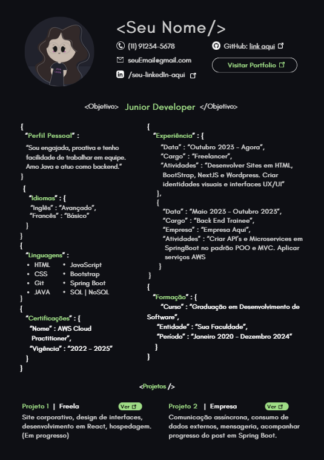

# Currículo e Entrevistas para Devs

Modelos de currículo e material de preparação para entrevistas de tecnologia, feitos por [@mandis.dev](https://www.instagram.com/mandis.dev/).

Aqui você encontra:

- **2 modelos de currículo:** um para passar por sistemas de triagem (ATS) e outro para chamar atenção no LinkedIn.

> Todos os dados dos modelos (nome, e-mail, empresas, datas e números) são **fictícios**. Substitua pelos seus.

## Conteúdo

```
.
├── README.md
├── modelo-ats.html        # modelo simples, uma coluna, para triagem
└── modelo-visual.png      # prévia do modelo visual (link do Canva abaixo)
```

## Qual modelo usar?

| | **Modelo ATS** | **Modelo visual** |
|---|---|---|
| Aparência | Simples, uma coluna, só texto | Colorido, em estilo de código, com ícones |
| Melhor para | Candidaturas em plataformas de vagas e envio por e-mail | LinkedIn, portfólio e envio direto a pessoas |
| Vantagem | Fácil de ser lido por sistemas de triagem | Chama atenção e é compartilhável |
| Risco | Visual discreto | Colunas, ícones e elementos gráficos podem atrapalhar a leitura automática |

**Minha experiência:** o modelo visual alcançou quase 200 mil pessoas no LinkedIn e me deu visibilidade. O modelo simples foi o que me levou às entrevistas e ao retorno de vagas em geral. Cada um tem uma função, então use o certo para cada situação.

> Nenhum modelo garante aprovação. Sistemas de triagem variam de empresa para empresa, e o que mais pesa continua sendo o conteúdo do currículo.

## Como usar o modelo ATS (HTML)

1. Abra `curriculo/modelo-ats.html` em um editor de código e troque o que está em `[colchetes]` e os dados de exemplo.
2. Abra o arquivo no navegador.
3. Pressione `Ctrl + P` (ou `Cmd + P` no Mac).
4. Em **Destino**, escolha **Salvar como PDF**. Em **Papel**, escolha A4 e, em **Margens**, escolha **Nenhuma**.
5. Salve com um nome claro, como `nome-sobrenome-desenvolvedor-fullstack.pdf`.

**Teste final:** abra o PDF, selecione tudo, copie e cole no Bloco de Notas. Se o texto sair na ordem certa, um sistema de triagem tem mais chance de ler bem. Se sair embaralhado, revise o arquivo.

## Como usar o modelo visual (Canva)

Abra o modelo, clique para usar uma cópia e edite com os seus dados:

👉 **[Modelo visual no Canva](https://canva.link/ysaeihbh3x00f9k)**



Use esse modelo para LinkedIn, portfólio ou envio direto, e prefira o modelo ATS quando a candidatura passar por uma plataforma de vagas.

## Dicas de currículo

1. **Uma coluna e títulos claros**, como "Experiência" e "Formação". Evite tabelas, ícones e barras de nível de habilidade nos currículos enviados a plataformas.
2. **Use as palavras da vaga.** Se a vaga pede "Node.js" e "testes automatizados" e você tem essa experiência, escreva exatamente assim.
3. **Mostre resultado, não só tarefa.** Em vez de "fiz uma API", escreva "reduzi o tempo de resposta da API em [X]%".
4. **Mantenha curto:** uma página é o ideal, duas só se houver muita experiência relevante.
5. **Confira os links.** LinkedIn, GitHub e portfólio precisam abrir e estar atualizados, porque muita gente confere.
6. **Esteja preparado para falar de cada item.** Tudo que está no currículo pode virar pergunta. Se não explicar um projeto com clareza, não coloque.

## Entrevistas

O repositório [entrevista-CI&T](https://github.com/mandis-dev/entrevista-ciandt) traz 21 perguntas de uma entrevista técnica na CI&T, organizadas por tema, com:

- o que a pessoa entrevistadora quer descobrir,
- um caminho de resposta,
- o erro mais comum.

A regra que vale para quase todas: responda em **Problema → Solução → Resultado**.

## Uso

Fique à vontade para usar e adaptar este material para a sua candidatura. Se ele te ajudou e você compartilhar, marcar o perfil [@mandis.dev](https://www.instagram.com/mandis.dev/) é sempre bem-vindo.

## Me segue no Instagram

Eu posto conteúdo sobre carreira em tecnologia, entrevistas, currículo, vagas abertas e dicas de AWS, sempre explicado para quem está começando.

👉 **[instagram.com/mandis.dev](https://www.instagram.com/mandis.dev/)**

Se este repositório te ajudou, deixa uma ⭐ e me conta lá qual foi a sua maior dificuldade em entrevista.
